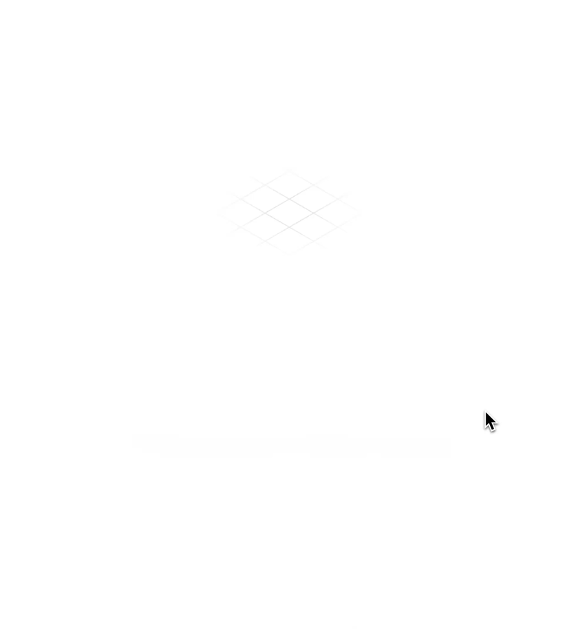

# Lost Cube

A 404 page with an isometric cube that follows the cursor and rolls across a faded grid, looking for the page that isn't there.

You can also click or tap a square to send the cube there. Neat for touchscreens.

One HTML file, about 43 KB. Plain SVG and JavaScript. No build step or dependencies.

**[Try it live →](https://heytomchris.github.io/lost-cube/)**

  

## Use it

Copy [`404.html`](404.html) to the root of your site. It’s the only file you need. `index.html` is just the demo.

Most static hosts use a root `404.html` automatically. Otherwise, point your server’s not-found page at it.

“Back home” goes to `/`. If your site lives under a path, change the link’s `href`.

## Contributing

Open to contributions. Curious what you'll come up with.

## Credits

Inspired by [Hairline](https://github.com/lucasmarkes/hairline) by Lucas Markes.

## License

Apache-2.0
